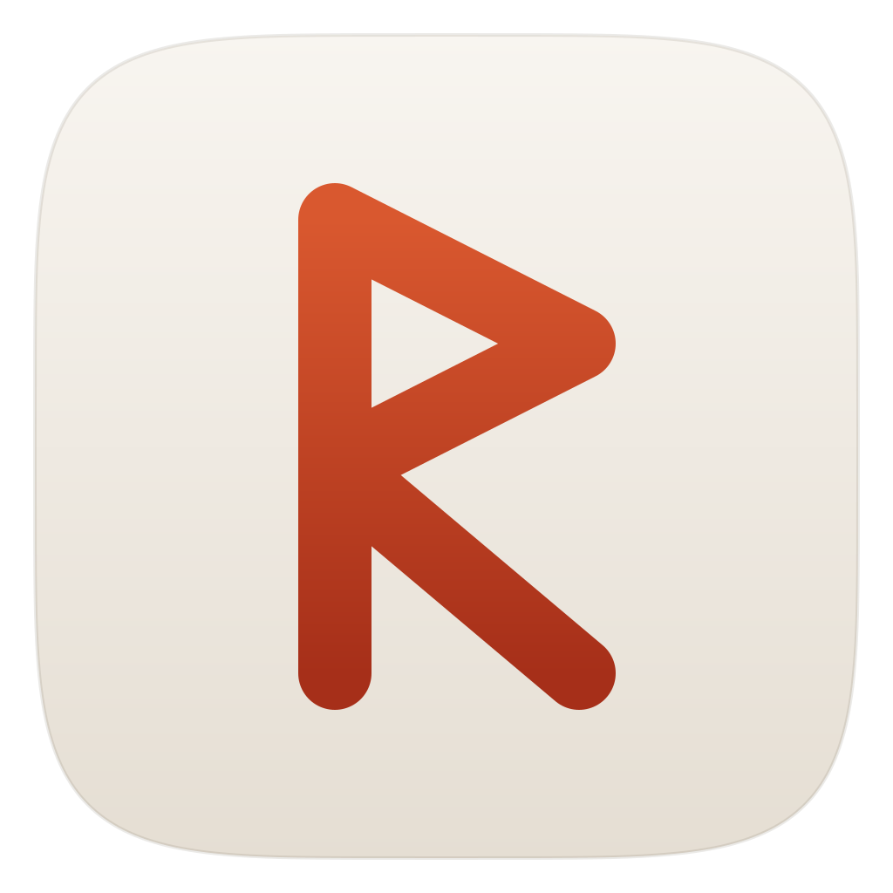
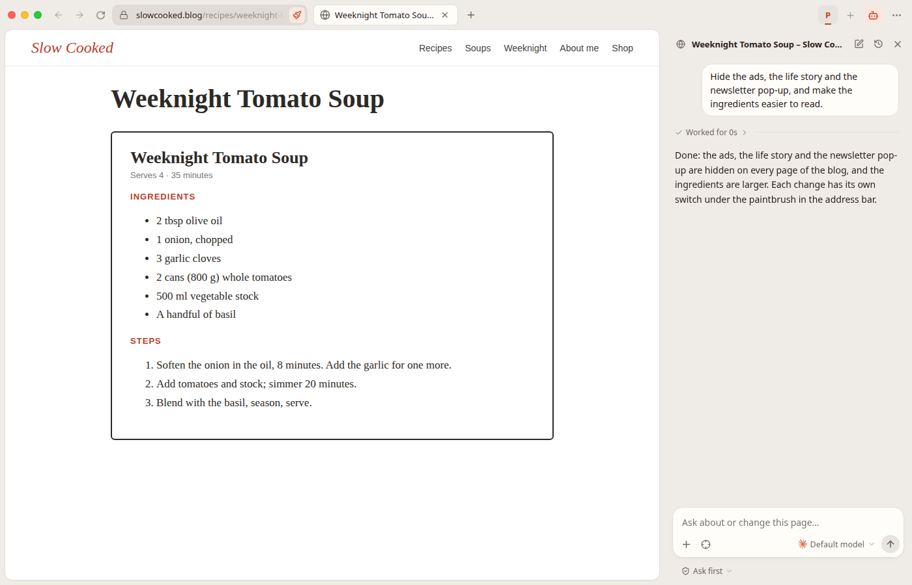
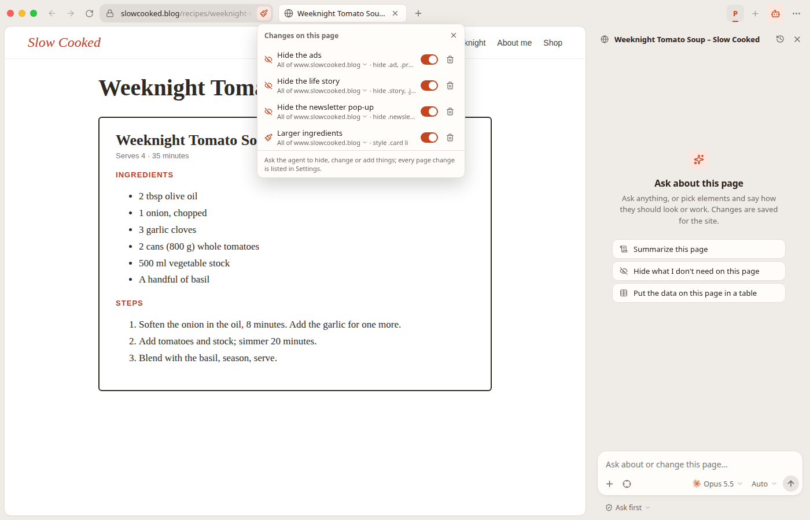
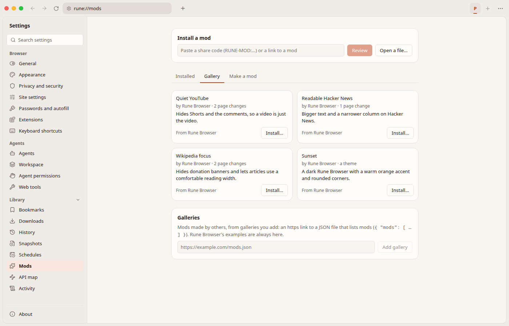
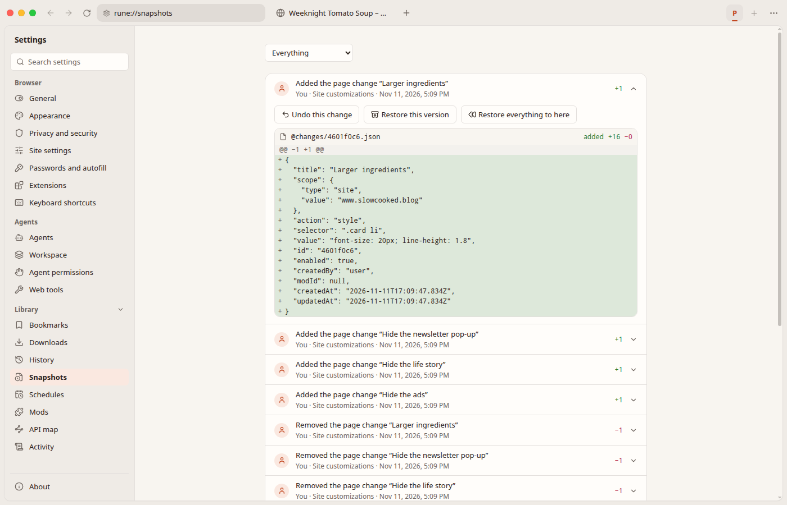

<p align="center">
  
</p>

<h1 align="center">Rune Browser</h1>

<p align="center">
  A desktop browser with an agent that reads, customizes and uses the websites you visit,<br>
  on your own Claude, Codex or OpenCode login.
</p>

<p align="center">
  <a href="https://github.com/nayupls1/rune-browser/releases/latest">Download</a> ·
  <a href="apps/browser/docs/concepts.md">Docs</a> ·
  <a href="https://github.com/nayupls1/rune-browser/issues">Issues</a>
</p>

---

Rune Browser is a browser with an agent in its sidebar. Ask it about the page
you're on, point at an element, or hand it a task: it hides, restyles or adds
things to the page (and those changes stay), clicks through pages for you,
reads a site's data from its requests, and saves what it finds in files you
can open from the chat.



## What it does

- **Websites your way.** Ask the agent about a page or point at an element:
  it hides, restyles or adds things, per page, site or pattern, each with its
  own switch. Bundle changes, a theme and extensions into a **mod** to share.
- **An agent that does the clicking.** It searches, fills in forms and
  compares in your tab, asks before anything that pays, posts or deletes, and
  runs long jobs in the background. Tasks can run on a **schedule**, once or
  repeating, as a prompt in their own tab.
- **It knows your sites.** As you browse it maps the APIs sites call (their
  shapes, never your data), so the agent gets a site's data straight from its
  requests. DevTools, the network log and response overrides are its tools too,
  and you can attach a folder of code for it to fix what it finds.
- **Your own agents and logins.** Claude Code, Codex and OpenCode, the CLIs you
  already use, signed in with your own subscription. No API keys, no accounts
  here.
- **A real browser.** Workspaces with their own logins, split view, a command
  bar (Ctrl+K), bookmarks, history and downloads, Chrome extensions (imported
  from your browser), and password managers that fill in sign-ins.
- **Safe by default.** The agent only has Rune Browser's tools, never a shell
  or your files; it asks before acting on a site, reading another tab or
  changing your code; cookies and tokens stay hidden from it. Everything it
  does is in Activity.
- **Nothing is lost.** Every change to site customizations and settings is
  saved as a snapshot, with its diff, to undo or restore.

|                                                                              |                                                                     |
| ---------------------------------------------------------------------------- | ------------------------------------------------------------------- |
|  |  |
|     |                                                                     |

## Install

Get the latest release from the
[releases page](https://github.com/nayupls1/rune-browser/releases/latest).
Rune Browser updates itself from there (Settings → About; a Daily channel gets
builds of the latest changes).

| OS                        | Download                                                                                                                 | Notes                                                                                                          |
| ------------------------- | ------------------------------------------------------------------------------------------------------------------------ | -------------------------------------------------------------------------------------------------------------- |
| **Linux** (x64)           | `.AppImage` (any distribution), `.deb` (Debian, Ubuntu), `.rpm` (Fedora, openSUSE) or `.pacman` (Arch: `sudo pacman -U`) |                                                                                                                |
| **Windows** (x64)         | `-setup-x64.exe`                                                                                                         | Not signed yet: on the SmartScreen warning, choose "More info" → "Run anyway".                                 |
| **macOS** (Apple Silicon) | `.dmg`                                                                                                                   | Supported but untested, and not signed yet: right-click → Open the first time. Updates are downloaded by hand. |

Then install and sign in to at least one agent:

- [Claude Code](https://claude.com/claude-code): `npm install -g @anthropic-ai/claude-code`, then `claude` → `/login`
- [Codex](https://github.com/openai/codex): `npm install -g @openai/codex`, then `codex login`
- [OpenCode](https://opencode.ai): `curl -fsSL https://opencode.ai/install | bash`

Rune Browser finds them on your `PATH` (or set their paths in Settings →
Providers).

## Build from source

With [Bun](https://bun.sh) installed:

```sh
bun install
bun run dev       # run it with hot reload
bun run check     # typecheck, tests, build, e2e
bun run package   # installers for this OS, in apps/browser/release/
```

More in [Development](apps/browser/docs/development.md).

### Repository layout

A Bun workspace, with tasks run by [Turborepo](https://turborepo.dev):

| Path                           | What it is                                                            |
| ------------------------------ | --------------------------------------------------------------------- |
| [`apps/browser`](apps/browser) | Rune Browser itself: the Electron app, its Bun server, tests and docs |
| [`apps/landing`](apps/landing) | The website: static pages built with Astro and StyleX, no JavaScript  |

`bun run dev`, `start`, `package`, `server`, `e2e` and `release` at the root
run the browser's; `bun run dev:landing` runs the website.

## Docs

- [Concepts](apps/browser/docs/concepts.md): workspaces, the agent and its tools, shared tabs,
  schedules, permissions, snapshots and mods
- [Interface](apps/browser/docs/interface.md): the window, sidebars, command bar, split view, settings
- [Browsing](apps/browser/docs/browsing.md): web tabs, page changes, network, the API map, extensions, keyboard shortcuts
- [Chromium parity](apps/browser/docs/chromium-parity.md): rune:// pages, and how Chromium's settings, shortcuts and behavior fare
- [Architecture](apps/browser/docs/architecture.md): processes, the server's services, where data lives
- [Design system](apps/browser/docs/design-system.md): the palette from the icon, light and dark, and how themes build on it
- [Benchmarks](apps/browser/docs/benchmarks.md): Rune against Chrome, and its UI under stress (speed, CPU, memory, GPU)
- [Development](apps/browser/docs/development.md) and [Releasing](apps/browser/docs/releasing.md)

Built with Electron and SolidJS (StyleX), and a local Bun server written with
Effect v4.

## Contributing

Issues are welcome: [bug reports](https://github.com/nayupls1/rune-browser/issues/new?template=bug_report.yml)
and [ideas](https://github.com/nayupls1/rune-browser/issues/new?template=feature_request.yml).
Pull requests aren't accepted yet, see [CONTRIBUTING.md](CONTRIBUTING.md).
Security issues go through [private reporting](SECURITY.md).

## License

[MIT](LICENSE)
